<h1 align="center">SCARA Robot · ROS 2 Digital Twin</h1>

<p align="center">
  A 4-axis SCARA arm that sorts coloured parts off a conveyor – in <b>Gazebo</b>, in <b>MuJoCo</b> and on the
  <b>real 3-D printed robot</b> – driven from one app on your phone or PC.
</p>

<p align="center">
  
  
  
  
  
  
</p>

<p align="center">
  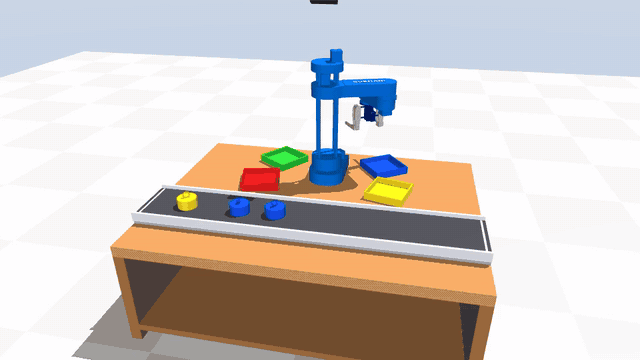
</p>

The robot is the HowToMechatronics SCARA (column, Z axis, elbow, wrist and a two-finger gripper).
One robot description feeds every simulator, and one twin server connects them to the real arm:

* **Sorting cell** – a conveyor brings coloured pucks, a camera finds them, the arm sorts them by
  colour, or only picks what you ask for ("red then blue", "3 green").
* **Digital twin** – the real robot copies the simulation, or the simulation follows the robot;
  with the webcam cell the 3-D view shows the real conveyor and every cube the camera sees.
* **One app, phone and PC** – Android APK and browser GUI are the same program: joysticks,
  FK / IK, voice, **MediaPipe hand tracking** (offline, one or two hands), sliders, dark / light,
  teach & replay with **programs you can export and import**, **draw a path** for the gripper,
  **belt tracking** and a **demo for the review** – and an offline simulator that needs no PC.
* **Real hardware** – Arduino firmware (CNC shield, A4988, limit-switch homing), a webcam cell
  that needs no depth camera, a safety filter in front of every manual move, and a step-by-step
  **bring-up check** for the day you build it ([docs/HARDWARE_GUIDE.md](docs/HARDWARE_GUIDE.md)).

## Highlights

| | |
|---|---|
| 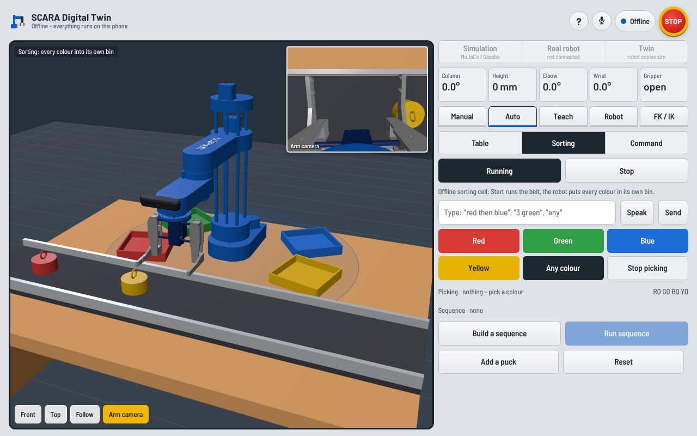 | **A control room on the PC, a pendant on the phone.** `scara_twin_server.py` serves the PC page at http://localhost:8080 (it connects by itself); the phone gets the pendant layout of the same program, offline too. |
| 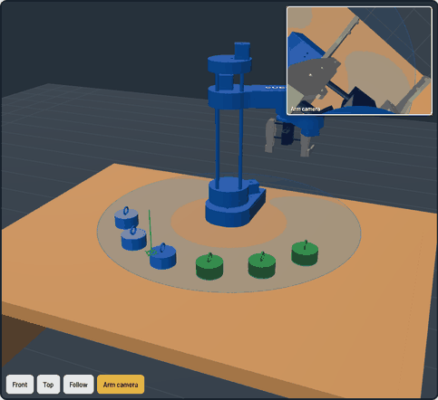 | **Forward and inverse kinematics, live.** Gripper pose, reach and manipulability as you move; type a point (or tap the table), compare both elbow solutions against the joint limits, press *Go*. |
| 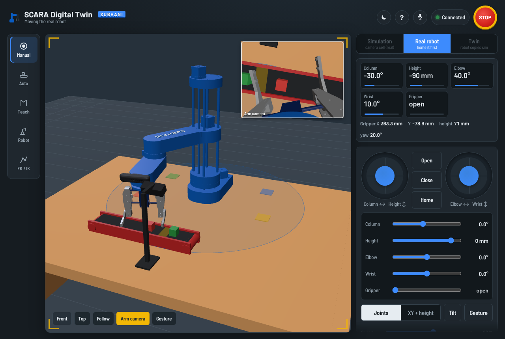 | **Hardware twin.** The real cell as it stands on the table: the short red conveyor where you taught the pick point, the webcam on its stand, the drop spots and the cubes the webcam sees. |
| 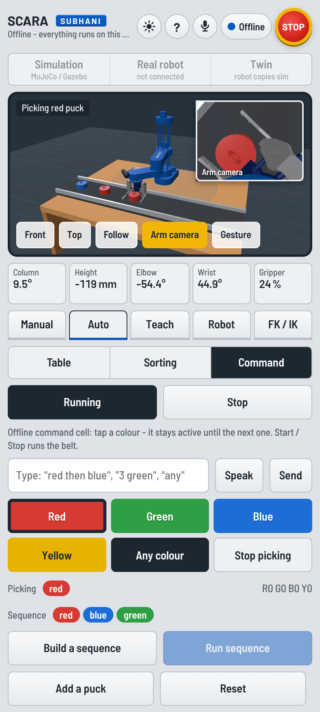 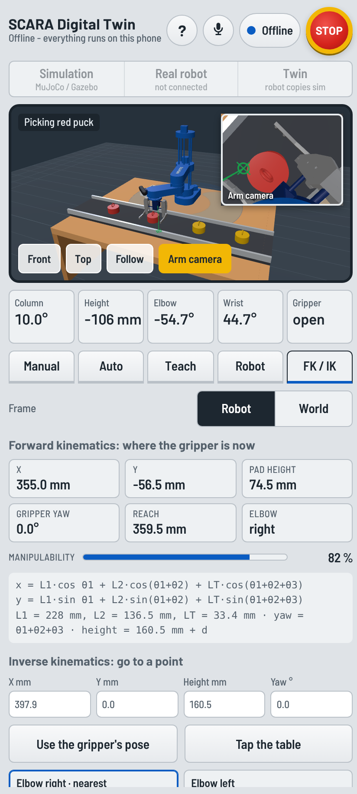 | **Voice and gesture control.** Say "red then blue" or "close"; move your hand in front of the camera to drive the arm and make a fist to grip. Works offline on the phone. |

| Gazebo / MuJoCo command cell | Manual table | Digital twin in RViz |
|---|---|---|
| 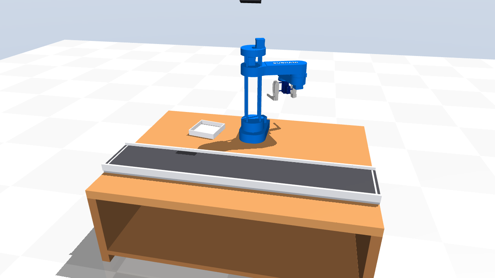 | 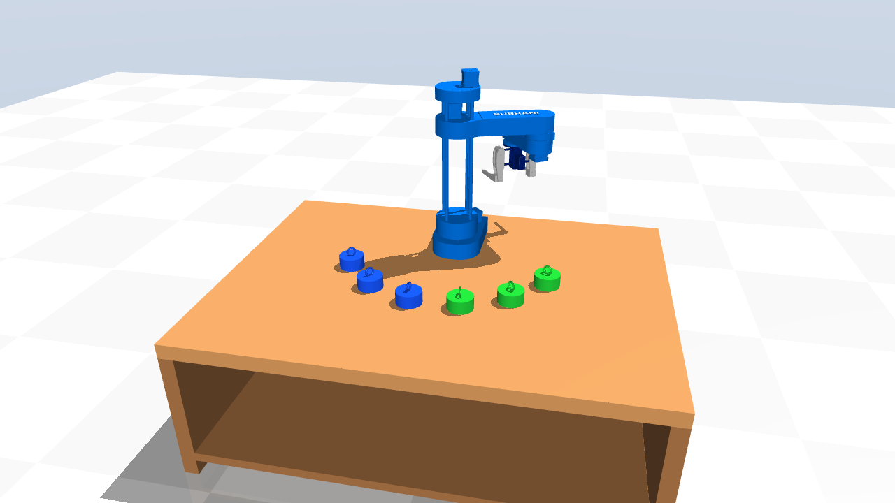 | 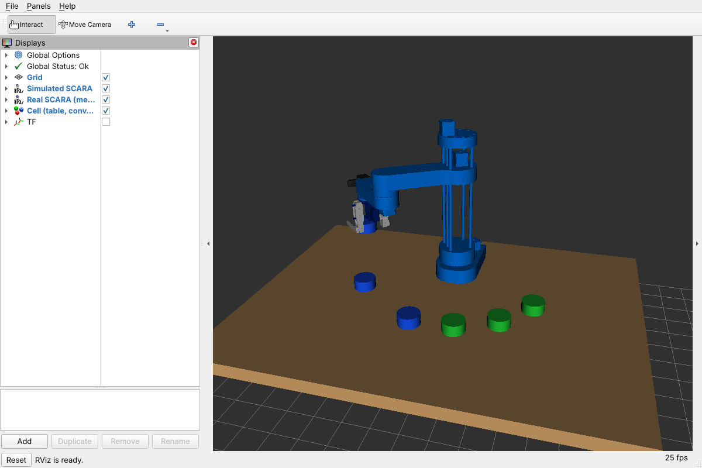 |

### How it fits together

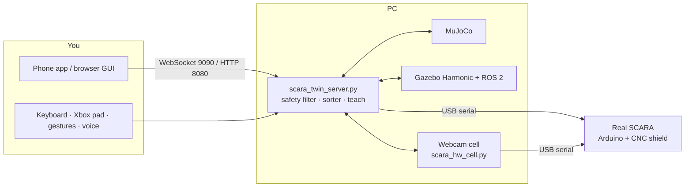

## Project layout

Every folder holds one kind of thing, so you can find what you need without reading code:

```
Scara_robot/
├── mujoco/            MuJoCo: the programs (launch_mujoco.py, teleop, joystick, twin, ROS bridge)
│   └── models/        the MuJoCo scenes (sorting cell, command cell, table)
├── gazebo/            Gazebo + ROS 2 nodes: sorter, vision, puck spawner, teleop, joystick, ask, doctor
│   └── worlds/        the Gazebo worlds (sorting, command, table)
├── real_robot/        the real arm: webcam cell, camera setup, ROS twin bridge
│   └── firmware/      the Arduino sketch (scara_twin.ino)
├── server/            scara_twin_server.py: the website GUI, the phone app connection and the digital twin
├── app/               the phone app (APK), its web page app/ui (also the website) and the Android shell
├── gesture_control/   two-hand webcam gestures for MuJoCo and Gazebo
├── common/            shared by everything: dimensions, kinematics, safety, sorter, voice, robot protocol
├── urdf/  meshes/     the robot model (ROS standard places)
├── launch/  config/   ROS 2 launch files and settings (ROS standard places)
├── tools/             build scripts and the automated tests
└── docs/              wiring diagram, pictures for this README
```

After `colcon build` everything is installed the usual ROS way (`share/scara_description/worlds`,
`.../mujoco/models`, `.../firmware`, programs in `lib/scara_description`), so the launch files and
`ros2 run` work the same as before.

## Contents

0. [Project layout](#project-layout) – which folder holds what
1. [Get the code](#1-get-the-code) – clone, or unzip the release
2. [Install](#2-install)
3. [Quick start – every way to run it](#3-quick-start)
4. [Gazebo](#4-gazebo)
5. [MuJoCo](#5-mujoco)
6. [Command mode, sequences and voice](#6-command-mode-sequences-and-voice)
7. [Manual control and the safety mode](#7-manual-control-and-the-safety-mode)
8. [The app: browser GUI and phone](#8-the-app-browser-gui-and-phone)
9. [App features: FK / IK, voice, gesture control](#9-app-features-fk--ik-voice-gesture-control)
10. [The real robot: wiring, firmware, first start](#10-the-real-robot)
11. [Real robot, autonomous: the camera cell](#11-real-robot-autonomous-the-camera-cell)
12. [Digital twin](#12-digital-twin)
13. [The name on the shoulder link](#13-the-name-on-the-shoulder-link)
14. [Reference: launch arguments, scripts, topics](#14-reference)
15. [How the code fits together](#15-how-the-code-fits-together)
16. [Testing](#16-testing)
17. [Troubleshooting](#17-troubleshooting)
18. [Licence, credits and author](#18-licence-credits-and-author)

---

## 1. Get the code

**From GitHub**

```bash
git clone https://github.com/Iamsubhani11/SCARA_ROBOT-ros2.git ~/Scara_robot
```

**From the release zip** (`SCARA_ROBOT-ros2.zip`):

```bash
cd ~/Downloads
unzip SCARA_ROBOT-ros2.zip
mv SCARA_ROBOT-ros2 ~/Scara_robot     # the zip holds one folder
cd ~/Scara_robot
```

The ready-built phone app is in `app/`. The reference videos are not part of the code – keep them
outside this folder.

---

## 2. Install

Tested on **Ubuntu 22.04 + ROS 2 Humble + Gazebo Harmonic**, Python 3.10. Gazebo itself was
also run headless with the Jazzy/Harmonic stack while preparing this release (section 16).
The MuJoCo tools work on any OS with Python 3.9 or newer.

### 2.1 ROS 2 and Gazebo

```bash
sudo apt update
sudo apt install -y git python3-pip python3-colcon-common-extensions \
  ros-humble-ros2-control ros-humble-ros2-controllers ros-humble-xacro \
  ros-humble-robot-state-publisher ros-humble-joint-state-publisher-gui \
  ros-humble-rviz2 ros-humble-rosbridge-server \
  python3-serial portaudio19-dev espeak-ng
```

Humble's own packages are built for the old Gazebo (Fortress). For **Harmonic** you need the
Harmonic builds of `ros_gz` and `gz_ros2_control`:

```bash
sudo apt install -y gz-harmonic ros-humble-ros-gzharmonic     # from packages.osrfoundation.org
mkdir -p ~/gz_ros2_control_ws/src && cd ~/gz_ros2_control_ws/src
git clone -b humble https://github.com/ros-controls/gz_ros2_control.git
cd ~/gz_ros2_control_ws && source /opt/ros/humble/setup.bash
export GZ_VERSION=harmonic && colcon build
```

(On Ubuntu 24.04 with Jazzy all of this is simply `sudo apt install ros-jazzy-ros-gz ros-jazzy-gz-ros2-control ros-jazzy-ros2-controllers`.)

### 2.2 This package

```bash
cd ~/Scara_robot
python3 -m pip install -r requirements.txt
source /opt/ros/humble/setup.bash
colcon build --symlink-install
```

### 2.3 Every new terminal

Add to `~/.bashrc`:

```bash
source /opt/ros/humble/setup.bash
source ~/gz_ros2_control_ws/install/setup.bash
source ~/Scara_robot/install/setup.bash
```

The Gazebo launch file finds the `gz_ros2_control` plugin in `~/gz_ros2_control_ws` by itself. If
you built it somewhere else, also add
`export GZ_SIM_SYSTEM_PLUGIN_PATH=<that workspace>/install/gz_ros2_control/lib:$GZ_SIM_SYSTEM_PLUGIN_PATH`.

A few one-time permissions:

```bash
sudo usermod -aG dialout $USER     # the Arduino (/dev/ttyACM0)
sudo usermod -aG input $USER       # the Xbox pad (/dev/input/js0)
# then log out and back in
```

Every program can be started from `~/Scara_robot` with its folder, e.g. `python3 mujoco/launch_mujoco.py`,
or after `colcon build` as `ros2 run scara_description <name>.py` (the folder does not matter there).
The folders are explained in [Project layout](#project-layout).

---

## 3. Quick start

| What | Gazebo | MuJoCo |
|---|---|---|
| Sorting – every colour into its own bin | `ros2 launch scara_description gazebo.launch.py` | `python3 mujoco/launch_mujoco.py --auto --show` |
| Command mode, type colours | `ros2 launch scara_description gazebo.launch.py mode:=command` and `python3 gazebo/scara_ask.py` | `python3 mujoco/launch_mujoco.py --command` |
| Command mode, voice | same, `scara_ask.py --voice` | `python3 mujoco/launch_mujoco.py --command --voice --show` |
| Command mode from GUI / phone | `... mode:=command` and `python3 server/scara_twin_server.py --sim gazebo` | `python3 server/scara_twin_server.py --world command` (or switch worlds in the app's Auto tab) |
| Keyboard | `... mode:=manual` and `python3 gazebo/scara_teleop.py` | `python3 mujoco/scara_mujoco_teleop.py` |
| Xbox pad | `... mode:=manual` and `python3 gazebo/scara_joystick.py` | `python3 mujoco/scara_mujoco_joystick.py` |
| Hand gestures | `... mode:=manual` and `python3 gesture_control/gesture_control_ros2.py` | `python3 gesture_control/gesture_control_mujoco.py` |
| Browser GUI / phone app | `... mode:=manual` and `python3 server/scara_twin_server.py --sim gazebo` | `python3 mujoco/launch_mujoco.py --gui` |
| Real robot in the GUI / app | add `--port /dev/ttyACM0` to `scara_twin_server.py` | same |
| Real robot sorting by itself (webcam) | – | `python3 real_robot/scara_hw_cell.py --port /dev/ttyACM0` (section 11) |
| RViz with robot and cell | `... gazebo.launch.py rviz:=true` | `ros2 launch scara_description mujoco_ros.launch.py rviz:=true` |
| Digital twin in RViz | `ros2 launch scara_description digital_twin.launch.py port:=/dev/ttyACM0` | `ros2 launch scara_description mujoco_ros.launch.py mode:=manual twin:=true port:=/dev/ttyACM0 rviz:=true` |
| Gazebo without a window | `... gazebo.launch.py headless:=true` | – |
| What is wrong with my running cell? | `python3 gazebo/scara_doctor.py` | same, with `mujoco_ros.launch.py` |

Only one program should move the arm at a time. That is why the keyboard, pad, gestures and GUI
use `mode:=manual` in Gazebo – no sorter runs there. No hardware yet? `--fake` (GUI) or
`fake:=true` (launch files) starts a software copy of the robot firmware.

### 3.1 Every mode – from the app / website, or from a terminal

Start **one** server and you can reach every mode from the app and the website; or start each mode
on its own in a terminal. Both ways do the same thing.

```bash
python3 server/scara_twin_server.py                         # MuJoCo (all three worlds)
python3 server/scara_twin_server.py --sim gazebo --world sort   # Gazebo (the server starts it)
```
Then http://localhost:8080 on the PC, or the phone app → the PC's address, port 9090.

| mode | in the app / website | in a terminal instead |
|---|---|---|
| Table (manual picking) | Auto tab → **Table**; Manual tab drives | `gazebo.launch.py mode:=manual` · `launch_mujoco.py` |
| Sorting cell | Auto tab → **Sorting** → Start | `gazebo.launch.py` · `launch_mujoco.py --auto --show` |
| Command cell | Auto tab → **Command**, colours / sequence / typed / spoken | `gazebo.launch.py mode:=command` + `scara_ask.py` · `launch_mujoco.py --command` |
| Belt tracking (3.3, MuJoCo and offline – not Gazebo yet) | Command cell → **Follow belt** | `launch_mujoco.py --command --track-belt` |
| Joysticks: joints / XY + height | Manual tab | `scara_teleop.py` · `scara_mujoco_teleop.py` (keyboard) |
| Sliders | Manual tab → Sliders (PC: always shown) | – |
| Keyboard / gamepad | just use it on the page (also a keyboard or pad on the phone) | `scara_joystick.py` · `scara_mujoco_joystick.py` |
| Gesture (MediaPipe, 3.3) | **Gesture** button | `gesture_control_ros2.py` · `gesture_control_mujoco.py` |
| Voice | microphone button / *Speak* | `scara_ask.py --voice` · `launch_mujoco.py --command --voice` |
| Tap to move a puck | Manual tab → *Tap to move a puck* | – |
| FK / IK, go to a point | FK / IK tab | – |
| Draw a path (3.3) | FK / IK tab → *Draw on the table* or a shape → *Run path* | – |
| Teach, programs (3.3) | Teach tab: save poses, Play / Loop, programs, Export / Import | – |
| Demo for the review (3.3) | Auto tab → **Demo for the review** | – |
| Real robot / digital twin | Robot tab → Connect → Home → **Twin** at the top | `scara_twin_server.py --port /dev/ttyACM0` |
| Real camera cell | Robot / Auto tabs | `scara_hw_cell.py --port /dev/ttyACM0` |
| First start of the real robot | – | `real_robot/scara_bringup.py --port /dev/ttyACM0` |
| Offline, no PC | **Try offline** (all of the above except the real robot) | – |

---

## 4. Gazebo

```bash
ros2 launch scara_description gazebo.launch.py                  # sorting: conveyor, 4 bins
ros2 launch scara_description gazebo.launch.py mode:=command     # command: conveyor, 1 bin, picks what you ask for
ros2 launch scara_description gazebo.launch.py mode:=manual      # table with 6 pucks, you drive
ros2 launch scara_description gazebo.launch.py headless:=true    # any of the above without the Gazebo window
```

What happens in the conveyor modes:

1. Pucks drop onto the start of the belt one at a time, in random colours (endless by default).
2. The depth camera above the belt finds them: colour gives the puck, depth gives its 3-D position.
3. When a puck the robot wants reaches it, the belt stops.
4. The arm goes down around the puck, closes, lifts and puts it in its bin.
5. The arm parks out of the camera's view and the belt runs again.

Two OpenCV windows show the fixed camera (with the boxes it detects) and the camera on the
gripper (`show:=false` turns them off).

| argument | default | |
|---|---|---|
| `mode` | `sort` | `sort` · `command` · `manual` |
| `pucks` | `0` | pucks to drop, 0 = never stop |
| `empty_bins` | `true` | sorted pucks are taken out of the bins after 2 s; `false` = the bins fill up |
| `capacity` | `4` | pucks per bin with `empty_bins:=false`, then "bin full" until you send `empty` |
| `show` | `true` | camera windows |
| `rviz` | `false` | RViz with the robot, the cell and the pucks |
| `headless` | `false` | Gazebo server only, no window (cameras still render) |

Useful topics while it runs:

```bash
ros2 topic pub --once /scara/pick_color std_msgs/msg/String "{data: 'stop'}"    # belt stop ('start' again)
ros2 topic pub --once /scara/pick_color std_msgs/msg/String "{data: 'empty'}"   # I emptied the bins
ros2 topic pub --once /scara/spawn_puck std_msgs/msg/String "{data: 'green'}"   # drop a green puck now
ros2 topic echo /scara/status                                                    # what the robot is doing
```

If something does not move (belt, pucks, arm), run `python3 gazebo/scara_doctor.py` in a second
terminal. It listens for 15 s and prints PASS/FAIL for the clock, joints, controllers, cameras,
vision, belt command, pucks and sorter – with the fix for the first thing that fails.

---

## 5. MuJoCo

MuJoCo needs no ROS at all and is the quickest way to see everything.

```bash
python3 mujoco/launch_mujoco.py                      # manual table, move the arm with the viewer's sliders
python3 mujoco/launch_mujoco.py --auto --show        # sorting, with the two camera windows
python3 mujoco/launch_mujoco.py --command            # command mode, type colours in this terminal
python3 mujoco/launch_mujoco.py --command --gui      # command mode with the browser GUI and the phone app
python3 mujoco/launch_mujoco.py --gui                # manual table with the browser GUI and the phone app (add --open to open the browser)
python3 server/scara_twin_server.py                  # same, and the GUI / app can switch between
                                                      #   table, sorting cell and command cell (--world sort)
```

`--seed N` changes the order of the pucks, `--keep-in-bins --capacity 4` lets the bins fill up,
`--twin /dev/ttyACM0` makes the real robot copy the simulated one.

There is also a MuJoCo backend with exactly the ROS interface of the Gazebo launch file, for
machines without Gazebo:

```bash
ros2 launch scara_description mujoco_ros.launch.py                  # sorting + sorter
ros2 launch scara_description mujoco_ros.launch.py mode:=command     # + scara_ask.py
ros2 launch scara_description mujoco_ros.launch.py mode:=manual      # + teleop / pad / gestures / GUI
```

---

## 6. Command mode, sequences and voice

Command mode has one bin and the belt never stops on its own – pucks you did not ask for just ride
past. A colour you ask for **stays active until you ask for something else**.

| you type / say | the robot |
|---|---|
| `red` | takes every red puck, until the next command |
| `blue` | switches to blue |
| `red blue`, "red and blue" | both colours |
| `any`, `all`, "everything" | every colour |
| `3 red`, "three red ones" | three red pucks, then waits |
| `sequence red blue green`, "red then blue then green" | one red, then one blue, then one green – in that order – then waits |
| `sequence 2 red blue` | red, red, blue |
| `none`, "nothing" | stop picking, the belt keeps running |
| `stop` / `start` | stop / restart the belt |
| `empty` | the bins were emptied (with `empty_bins:=false`) |

A pick that has already started is always finished first.

Where you can give commands:

```bash
python3 gazebo/scara_ask.py              # type (Gazebo or mujoco_ros)
python3 gazebo/scara_ask.py --voice      # talk: "Hey SCARA" ... "red"
python3 gazebo/pick_and_place.py red 2   # ask for two red pucks and wait until both are in the bin
ros2 topic pub --once /scara/pick_color std_msgs/msg/String "{data: 'sequence red blue'}"
```

…and the colour buttons and the sequence box in the browser GUI and in the phone app (*Cell* tab).

Voice: say **"Hey SCARA"**, it answers, then say the colour – or all at once: "Hey SCARA, pick the
yellow ones". Speech-to-text is offline Whisper if `openai-whisper` is installed, otherwise the
OpenAI Whisper API (`OPENAI_API_KEY`), otherwise Google's free recogniser. `--stt whisper|openai|google`
forces one, `--llm` lets ChatGPT understand free sentences, `--quiet` stops the spoken replies.

---

## 7. Manual control and the safety mode

The manual table has six pucks on an arc in front of the robot. To pick one by hand: open the
gripper, bring it roughly over the puck, lower Z, close, lift.

### Safety mode

Everything you do by hand – keyboard, pad, gestures, GUI, phone app, teach & replay – passes
through `common/scara_safety.py` first.

| | safe (default) | normal | off |
|---|---|---|---|
| column / elbow speed | 0.6 rad/s | 1.2 rad/s | no limit |
| Z speed | 40 mm/s | 80 mm/s | no limit |
| wrist speed | 1.0 rad/s | 2.0 rad/s | no limit |
| pick assist, puck guard, table floor | on | on | off |
| emergency stop | yes | yes | yes |

* **Pick assist** – lower the open gripper near a puck (within about 45 mm) and the arm centres
  itself over it, so the fingers go down around the puck instead of onto it.
* **Puck guard** – if a finger would land on top of a puck, Z stops just above it. (This was the
  old "Z does not work at the gripper" problem: a finger was sitting on the puck.)
* **Speed slider** (GUI and app) scales the speeds above from 10 to 100 %.
* **Emergency stop** freezes the arm where it is; the same key or button releases it.

| | next safety mode | emergency stop |
|---|---|---|
| keyboard | `m` | `Space` |
| Xbox pad | START | BACK |
| gestures | `m` in the camera window | `Space` |
| GUI / phone | *Safety* card / *Manual* tab | STOP button (`Space` in the GUI) |

### Keyboard

```bash
python3 gazebo/scara_teleop.py          # Gazebo (mode:=manual)
python3 mujoco/scara_mujoco_teleop.py   # MuJoCo
```

`a`/`d` column, `w`/`s` Z, `j`/`l` elbow, `i`/`k` wrist, `o`/`u` close/open (MuJoCo: `g`/`o`),
`h` home, `Space` stop, `m` safety mode, `q` quit.

### Xbox pad

```bash
python3 gazebo/scara_joystick.py          # Gazebo (mode:=manual), reads /dev/input/js0 directly
python3 mujoco/scara_mujoco_joystick.py   # MuJoCo
```

Left stick: column and Z. Right stick: elbow and wrist. A/B close/open, Y home, hold LB/RB for
slow/fast. `--device /dev/input/js1` for another pad, `--layout gamecontroller` if the right stick
is on axes 2/3.

### Hand gestures

```bash
python3 gesture_control/gesture_control_ros2.py     # Gazebo (mode:=manual)
python3 gesture_control/gesture_control_mujoco.py   # MuJoCo
```

Left hand: move sideways for the column, up/down for Z. Right hand: sideways for the elbow, tilt
for the wrist, pinch thumb and index (hold it a moment) to close the gripper, let go to open. A
fist freezes that hand. Sit about 60 cm from the webcam, both palms towards it.

---

## 8. The app: browser GUI and phone

The browser GUI and the Android app are **one program** (`app/ui`). The twin server on the PC
serves it to the browser, and the APK carries a copy for the phone.

```bash
python3 server/scara_twin_server.py                          # MuJoCo (switch worlds in the app)
python3 server/scara_twin_server.py --world command          # ... starting in the command cell
python3 server/scara_twin_server.py --sim gazebo --world sort    # starts Gazebo itself, in that world
python3 server/scara_twin_server.py --sim gazebo             # follow a Gazebo you started yourself
python3 server/scara_twin_server.py --port /dev/ttyACM0      # + the real robot
python3 server/scara_twin_server.py --fake                   # + a software robot
python3 server/scara_twin_server.py --sim hardware --port /dev/ttyACM0   # the real webcam cell (section 11)
```

Open **http://localhost:8080** in the browser – the page connects by itself. The browser only opens
on its own when you ask for it with `--open` (other devices on the Wi-Fi:
`http://<pc-ip>:8080`). The phone app connects to `ws://<pc-ip>:9090` – the server prints both.
*Try offline* (or opening `app/ui/index.html` straight from the disk) runs the robot, the table and
the conveyor cell inside the page, with no PC and no ROS.

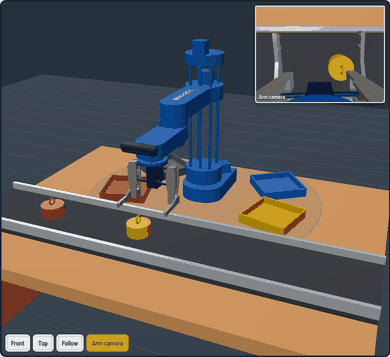

**Phone install:** `app/SCARA_Digital_Twin_v3.apk` (version 3.2). Versions 3.0 and 3.1 update in place; an
older v1 / v2 app must be uninstalled first (different signature). The full guide is in [app/README.md](app/README.md) and behind the **?** button.

| portrait | landscape |
|---|---|
|  | 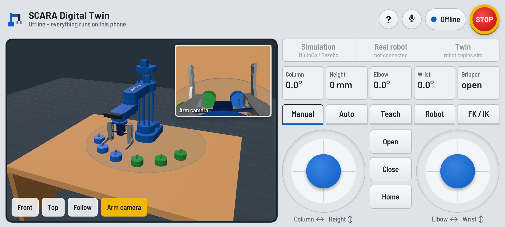 |

What is where:

| Tab | What you do there |
|---|---|
| **Manual** | **Joysticks or Sliders** (one slider per joint and the gripper; the PC page shows both) – joint by joint, or **XY + height** (straight lines over the table); tilt the phone, or **Gesture** (camera) to drive; open / close; speed; Safe / Normal / Off; tap a puck and a spot and the robot moves it. |
| **Auto** | Table / Sorting / Command world, Start / Stop, colour buttons that stay active, sequences, a command box you can type or **speak** into, totals. |
| **Teach** | Save poses, play once or in a loop; **exact-position sliders** for every joint. |
| **Robot** | Serial port, connect, home, zero, motors on / free, the **Direction check** for the first session with the real robot, the camera-cell poses, the **Activity** log. |
| **FK / IK** | Section 9. |

At the top: the target switch **Simulation / Real robot / Twin**, the microphone, the connection
pill and a latching **STOP**. Under the 3-D view: Front / Top / Follow, the arm camera and **Gesture**.

| PC, dark (the default on a computer) | PC, light | phone, dark |
|---|---|---|
|  | 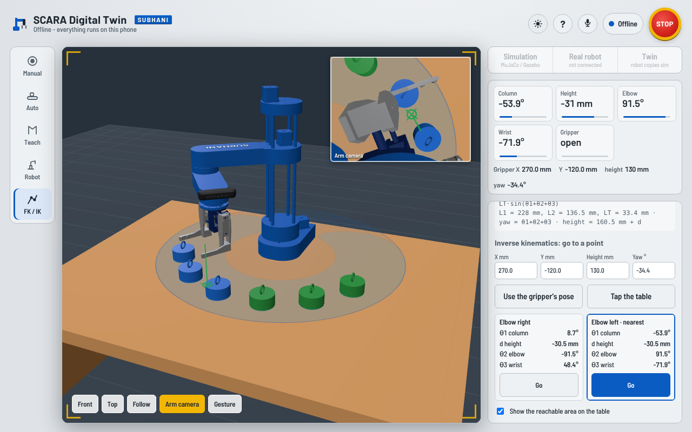 | 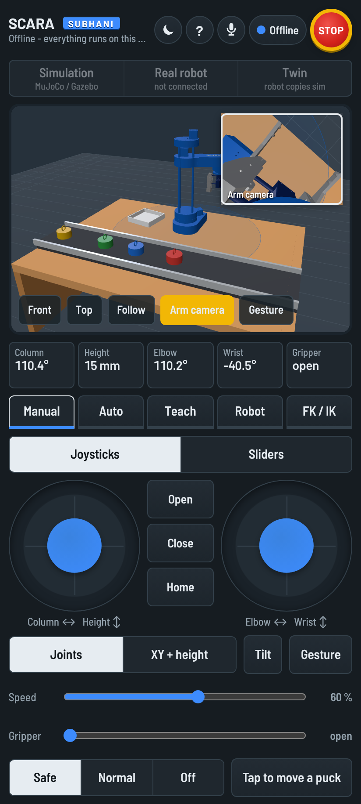 |

**Phone and PC look different on purpose.** The phone is a light teach pendant that fits any phone
from 320 px wide (and large system text). The PC page is a dark control room: the tools on a rail at
the left, the 3-D cell in a guard window, and on the right the joints with bars that show how close
each one is to its limit (yellow near the end), the gripper position, and the open tool. Both have a
**dark / light** switch (the sun / moon button, key `T`); the phone starts light, the PC dark.

**Arm camera window:** pinch it with two fingers on the phone, or drag its corner with the mouse, to
make it smaller (it never grows past its normal size); double-click / double-tap for full size.

Keyboard (PC): `A`/`D` column, `W`/`S` Z, `J`/`L` elbow, `I`/`K` wrist, `G`/`O` close / open,
`H` home, `P` save pose, `V` voice, `Space` STOP / release.

**Gamepad / joystick (phone and website):** any USB or Bluetooth gamepad – Zebronics, Xbox, PlayStation,
generic – works in the browser and in the Android app (Bluetooth or an OTG cable). Press a button once so it
is seen. Left / right stick = the two on-screen joysticks (d-pad too); `A` close, `B` open, `X` home,
`Y` save pose, `LB`/`RB` slower / faster, `Start` STOP / release, `Select` belt on / off.

**Gesture camera:** opens in its own place – above the robot view on a phone, at the top of the right-hand
column on a tablet or PC – so the 3-D view is never made smaller. Drag the bar under the picture to resize it.
`Window` turns it into a floating window (drag the title, resize from the corner), `Small` into a corner
preview, `✕` closes it and stops gesture control. The picture shows the learn square, the still zone,
your hand and whether it reads open hand or fist.

Nothing moves the real robot before it is zeroed, and nothing moves while its motors are free.

---

## 9. App features: FK / IK, voice, gesture control

### Forward and inverse kinematics (FK / IK tab)

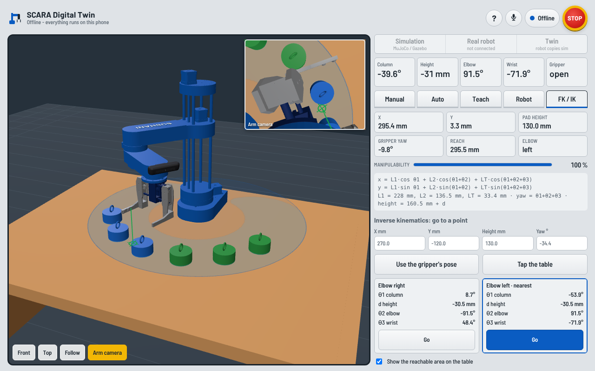

* **Forward kinematics, live** – where the gripper is: X, Y, pad height above the table, gripper yaw,
  reach from the column, which side the elbow is on, and the **manipulability** |sin θ2| (it warns
  near the straight-arm singularity). *Robot* frame = origin on the column axis, x along the arm at
  θ1 = 0; *World* frame = the simulator's.
* The formulas, with this robot's numbers:
  `x = L1·cos θ1 + L2·cos(θ1+θ2) + LT·cos(θ1+θ2+θ3)`, `y = L1·sin θ1 + L2·sin(θ1+θ2) + LT·sin(θ1+θ2+θ3)`,
  L1 = 228 mm, L2 = 136.5 mm, LT = 33.4 mm, height = 160.5 mm + d.
* **Inverse kinematics** – type X, Y, height and yaw, or *Tap the table*, or *Use the gripper's pose*.
  Both elbow solutions are listed with every joint value; a joint past its limit is shown in red and
  that solution cannot be sent. The one nearest to where the arm is now is marked; *Go* sends it.
* The area the gripper can really reach – joint limits included, not just a ring – is drawn on the
  table, with a marker on the IK target (green: reachable, red: not).

It works offline, against MuJoCo / Gazebo, and on the real robot.

### Voice

The microphone at the top, or *Speak* in the Auto tab. On the phone it uses Android's own speech
recogniser – **offline** if the phone has offline speech installed (Google app ▸ Settings ▸ Voice ▸
Offline speech recognition). In a browser it uses Chrome / Edge speech (online, and only on
`http://localhost` or https).

| say | the app |
|---|---|
| "red", "red then blue then green", "3 green", "any", "stop picking" | command-mode picks (switches to the command cell offline) |
| "start", "stop" | belt on / off |
| "open", "close", "home" | gripper and arm |
| "sorting", "command", "table" | world |
| "emergency stop" / "resume" | STOP / release |

Common mishearings are fixed for you ("read" → red, "blew" → blue, "grin" → green).

### Gesture (hand) control – MediaPipe

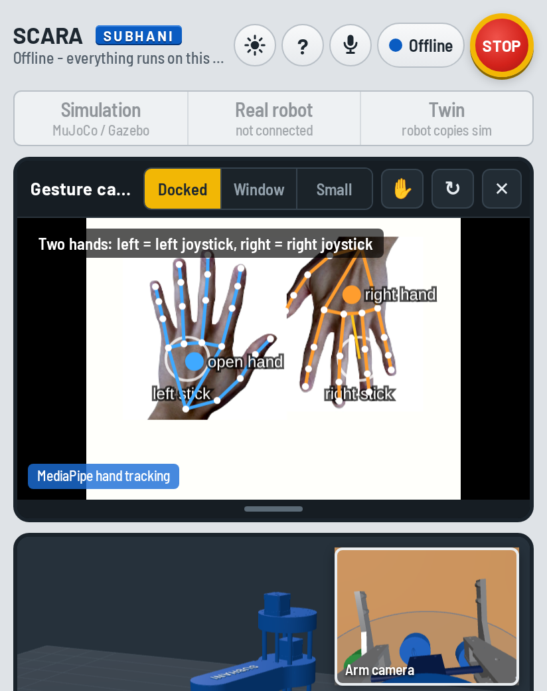

**Gesture** – the button under the 3-D view (also in the Manual tab) – uses the front camera (the
webcam on a PC). Since 3.3 it uses **MediaPipe Hand Landmarker**: 21 points on each hand, drawn on the
picture as a skeleton. It runs on the phone or PC itself, with no internet – the program and the model
are inside the app (`app/ui/lib/mediapipe`).

| your hand | the robot |
|---|---|
| palm in the middle circle | the arm stays still (a new hand first has to come to its circle) |
| move it left / right / up / down | the **left joystick** – faster the further you go |
| **fist** | close the gripper (hold it 0.3 s) |
| **open hand** | open the gripper |
| **pinch** (thumb + index) and move | the **right joystick** from where you pinched – in *XY + height* drive: up / down = height |
| **two hands** | left of the picture = left joystick, right of the picture = right joystick |

The window says which tracker runs (*MediaPipe hand tracking* in blue). If MediaPipe cannot start
(a very old phone, or `index.html` opened straight from a file in a normal browser), the old
**colour tracker** takes over by itself – hold your open palm in the yellow square for two seconds –
and the window says so. The ✋ button switches between them. If the camera cannot start, the window
says why in plain words:

| the window says | why / what to do |
|---|---|
| *Camera permission was refused* | allow the camera (address-bar icon; Android: Settings ▸ Apps ▸ SCARA Digital Twin ▸ Permissions) |
| *The browser only allows the camera on http://localhost, on https or in the Android app* | the website was opened from another computer over plain http – open it on the PC itself, or use the phone app |
| *The camera is busy* | close other apps / tabs that use it |
| *No hand seen – too dark / too much light behind you* | light on your hand, not behind it |

The camera window keeps its place (above the robot view on a phone, top of the right column on a
PC; *Window* / *Small* / ✕ in its title bar). (The two-hand gesture program for MuJoCo and Gazebo
without the app is in section 7.)

### Draw a path (FK / IK tab)

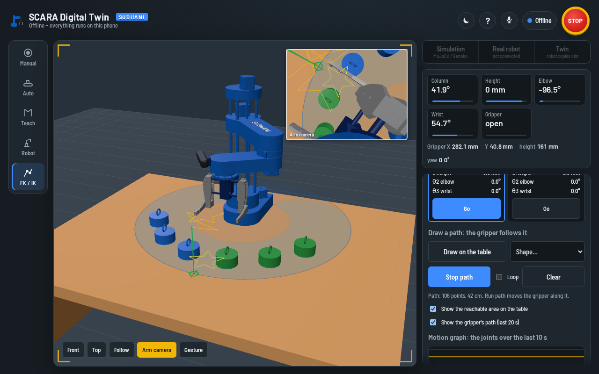

*Draw on the table* and draw with one finger (or the mouse) in the 3-D view, or pick a **circle,
square, star or figure 8**. The path is drawn on the table – yellow where the arm can reach, red where
it cannot. *Run path* first goes to its start, then moves the gripper along it at its present height,
solving the inverse kinematics for every point 4 mm apart (5 cm/s at 100 % speed, *Loop* to repeat).
It sends the same joint targets as the XY drive, so it works offline, in MuJoCo, in Gazebo and on the
real robot.

### Programs (Teach tab)

The poses in the Teach tab are a **program**. *Save as program* keeps it under a name on this device,
*Load* puts it back into the list (then *Play* / *Loop*), *Export file* downloads it as a `.json` file
and *Import file* reads one back. The phone app cannot download files: connected, *Export* saves it on
the PC in `~/scara_programs/`; offline it shows the text to copy, and *Import* takes pasted text.

```json
{"scara_program": 1, "name": "stack_3",
 "poses": [{"column_joint": 0.3, "shoulder_joint": -0.05, "forearm_joint": 0.6, "wrist_joint": 0.0, "left_finger_joint": 0.0}]}
```

### Belt tracking (Auto tab, command cell)

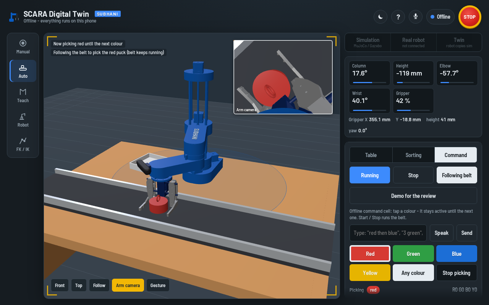

*Follow belt*: instead of stopping the belt for every pick, the robot meets the puck on the moving
belt and follows it while it goes down, closes and lifts. The camera gives the puck's place, the belt
speed is known, so its path is a straight line `p(t) = p₀ + v·t`. The arm follows it with the
**Jacobian** (resolved-rate control, `common/scara_kinematics.py`, `track_line`):

    q(k+1) = q(k) + J⁻¹(q(k)) · ( v + (p_wanted − p_now) / Δt ) · Δt,     det J = L1 · L2' · sin θ2

(L2' = L2 + LT = 169.9 mm, the elbow-to-pad length with the wrist at 0; det J = 0 is the straight arm,
where tracking is refused.)

The belt only pauses while the arm carries the puck to the bin. It is meant for the **command
cell**: a wanted puck that comes alone is followed; when wanted pucks crowd together, or in the
sorting cell (every puck wanted, one every 2.5 s), stopping the belt is better – our tests lost pucks
there – so the robot does that. Tested in MuJoCo (`MuJoCo belt tracking` in `run_all_tests.sh`) and
offline (`test_new_features.py`). The camera also measures the real belt speed (every puck it sees
again a little further on is one measurement) and the plan uses that, not the speed the belt was told.

**Not in Gazebo yet.** In Gazebo it is switched off and the belt stops for every pick, as before –
*Follow belt* says so. What we found: the camera time and the measured belt speed were right
(0.079 m/s), but Gazebo's arm controller follows its trajectory late (about 0.2 s in the first runs),
so the gripper came down 15–22 mm behind the puck and landed on its rim. With the path planned 0.2 s
ahead, 2 of 6 tracked picks came down around the puck (1 held, 1 slipped while lifting) and 4 landed on
top of it, 36 mm or more off: the lag changes from pick to pick, so a fixed lead cannot fix it.
The code for it is still there (`track_lead`, `tracking_off` in `gazebo/scara_color_sorter.py`); the
next step would be to correct the path while following (camera or joint feedback) instead of
planning it all in advance.

### Demo for the review (Auto tab)

One button for the presentation: the **table** (the gripper draws a star, then carries a puck to a new
place), the **sorting cell** (about 50 s) and the **command cell** ("red then blue", then every colour
with belt tracking – in Gazebo without it). Each world switch takes a moment (Gazebo restarts, about 30 s). Tap the button
again, or STOP, to end it.

---

## 10. The real robot

> **Building it now?** [docs/HARDWARE_GUIDE.md](docs/HARDWARE_GUIDE.md) is the one-page, step-by-step
> version: which build (with limit switches, or Mechamind-style without them – that decides the relay
> pin), the wiring, flashing, and `python3 real_robot/scara_bringup.py`, which checks the robot one
> thing at a time (connection, homing, each joint's direction, gripper, relay, digital twin) and tells
> you what to fix.

It is the HowToMechatronics SCARA: Arduino UNO, CNC Shield V3, 4 × A4988 drivers at ¼ step,
4 × NEMA 17, 4 limit switches and an MG996R servo gripper – plus a relay for the conveyor.

The pins, steps per degree, speeds and homing numbers in the firmware are the ones of the original
HowToMechatronics sketch, checked value by value. The original code is only in the download
on their page, so the numbers were taken from two forum posts that quote the sketch and agree with
each other:
[the build article](https://howtomechatronics.com/projects/scara-robot-how-to-build-your-own-arduino-based-robot/),
[Arduino forum 1](https://forum.arduino.cc/t/programming-scara-robot-in-python-arduino/950769),
[Arduino forum 2](https://forum.arduino.cc/t/servo-malfunction-with-robotic-arm/1107205).
Only two things are not from the original: the conveyor relay (the original robot has no conveyor)
and the gripper's closed angle (it depends on your gripper and on what it holds).

### 10.1 Wiring

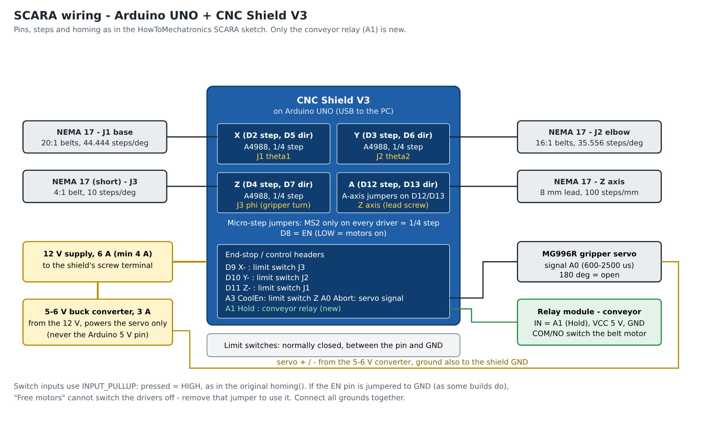

The pins are the ones of the original HowToMechatronics sketch:

| | pins (CNC shield) | |
|---|---|---|
| J1 base (θ1) | X slot: step D2, dir D5 | 20:1 belts → 44.444 steps/° |
| J2 elbow (θ2) | Y slot: step D3, dir D6 | 16:1 belts → 35.556 steps/° |
| J3 gripper turn (φ) | Z slot: step D4, dir D7 | 4:1 belt → 10 steps/° |
| Z axis | A slot: step D12, dir D13 (A-axis jumpers) | 8 mm lead screw → 100 steps/mm |
| limit switches | J1 → D11, J2 → D10, J3 → D9, Z → A3 | normally closed, to GND; pressed reads HIGH |
| gripper servo | A0 ("Abort"), 600–2500 µs | 180° = open |
| drivers enable | D8 | |
| conveyor relay | A1 ("Hold") – free in the original build | new, for the conveyor cell |

Power: 12 V, at least 4 A (6 A is better) into the shield's screw terminal, as in the article. Better
give the servo its own 5–6 V from a buck converter rather than the Arduino's 5 V pin – an MG996R
can pull more than 2 A when it squeezes. All grounds together. Set each A4988's current limit as
low as works without skipping steps. If your shield has a jumper from EN to GND (some builds do),
*Motors free* can't switch the drivers off – take the jumper out if you want that button.

### 10.2 Flash the firmware

1. Arduino IDE → Library Manager → install **AccelStepper** (Mike McCauley). Servo is built in.
2. Open `real_robot/firmware/scara_twin/scara_twin.ino`, board **Arduino UNO**, upload.
3. Serial Monitor at **115200**, line ending *Newline*. You see `I SCARA twin firmware ready`.
4. Send `K`. It homes Z, J3, J2, J1 on the switches exactly like the original sketch and parks
   with the arm straight and Z at 100 mm. (The original homes by itself at power-up; here it waits
   for `K`, so nothing moves until the PC asks.) Robot built without switches: set
   `#define USE_LIMIT_SWITCHES 0`, put the arm straight out with Z at 150 mm and send `H`.
5. `M 30 -45 0 120 0` moves it. Status lines `P ...` come 20 times a second.

| command | |
|---|---|
| `M j1 j2 j3 z_mm grip%` | move (degrees, degrees, degrees, mm, 0 = open … 100 = closed) |
| `K` | home on the limit switches (the original homing routine) |
| `H` | zero here – no switches: the arm is straight out, Z at 150 mm |
| `G deg` | gripper servo straight to an angle – to find your closed angle |
| `F` / `L` | motors free (move by hand) / locked |
| `C 1` / `C 0` | conveyor relay on / off |
| `S`, `V steps/s accel`, `?` | stop, speed, status now |

Speeds and accelerations (4000 steps/s, 2000 steps/s²), the steps-per-unit numbers and the
homing positions are the original sketch's. The one value you must set on your own robot is
`SERVO_CLOSED_DEG`: put a cube between the fingers, send `G 120`, `G 100`, `G 90` … and use the
angle where it just holds the cube firmly. Many blue
relay boards switch on with LOW – then set `RELAY_ACTIVE_LOW true`.

There are no encoders: the Arduino only counts the steps it sent. If the arm hits something and
loses steps, home it again with `K` (*Home on limit switches* in the GUI / app).

**Teach knobs** (Mechamind's potentiometer arm): `#define TEACH_WITH_POTS 1` and four
potentiometers on A1, A2, A4, A5 – the robot follows the knobs and the twin follows the robot.
A1 is the relay pin, so this mode needs `USE_LIMIT_SWITCHES 0` and has no conveyor.

### 10.3 First start with the PC

```bash
python3 server/scara_twin_server.py --sim none --port /dev/ttyACM0
```

In the GUI or the app: *Home on limit switches* (or *Zero here* on a robot without switches),
then move it with the sliders or the joysticks. If a joint turns the wrong way, flip its sign in `config/twin_hardware.yaml`
(`j1_sign`, …); if the zero is off, set the `*_offset_deg`.

---

**First session with the real robot – the direction check.** In the app or website: Robot tab →
connect → *Home switches* → choose **Twin** at the top. Under *Direction check* press **Nudge** for
each joint: the real arm and the 3-D arm both move a little. If the real one went the other way, press
**Opposite** – it is saved and every program (app, website, webcam cell, MuJoCo twin, ROS bridge) uses it.
With the robot connected, the sliders, IK and moves stay inside the robot's own range (column −89°…
266°, elbow ±150°, wrist ±162°, Z 0…170 mm, as in the firmware) so the simulation never goes where the
real arm cannot follow.

## 11. Real robot, autonomous: the camera cell

This is the Part 25 setup: the conveyor in front of the robot, **one ordinary USB webcam on a
stand** looking at the pick station, cubes on the belt. No depth camera and no camera on the
gripper (the simulation keeps its depth and wrist cameras – this is only for the real cell).

The camera doesn't need 3-D: the cubes ride on the belt, so all it has to know is how far a cube is
from the pick point along the belt. The robot side uses pick and drop poses you teach on the real
arm, so no camera-to-robot calibration with markers is needed.

How a cycle goes: belt on → a wanted cube enters the pick zone (the two orange lines in the
camera window) → belt off → the camera measures again on the still belt → the arm goes to the
taught pick pose, shifted along the belt by the measured distance → down, close, up → the camera
checks the cube really left the belt (if not, it tries once more) → drop pose for that colour →
open → park → belt on.

### 11.1 Train the camera (once, and whenever the camera moves)

```bash
python3 real_robot/scara_camera_setup.py               # camera 0
python3 real_robot/scara_camera_setup.py --source 1    # another camera
python3 real_robot/scara_camera_setup.py --source http://192.168.1.23:8080/video    # phone as IP camera
```

In the window:
1. `R` and drag a box around the belt.
2. `1` and click on a red cube, `2` green, `3` blue, `4` yellow. Click 2–3 cubes per colour, in
   different places – each click widens the colour a little. `0` forgets the colour you are on.
3. Put a cube exactly where the gripper will pick it, press `P` and click it.
4. Move that cube 60 mm upstream (towards where the cubes come from), press `U`, click it.
5. If the camera looks from the side, also move it 60 mm downstream of the pick point, `D`,
   click – this corrects the perspective.
6. `S` saves to `~/.scara_camera.json`. Every cube now shows its colour and distance, e.g.
   `green +35 mm`. With the cube at the pick point it should read about 0.

`[` and `]` make the pick zone narrower or wider, `F` flips the image if the camera hangs upside down.

### 11.2 Teach the robot poses (once)

```bash
python3 real_robot/scara_hw_cell.py --port /dev/ttyACM0 --teach --home
```

(`--home` homes on the limit switches first; without switches use `--zero-here` with the arm at the
ready pose.) Jog with `A`/`D` column, `W`/`S` height,
`J`/`L` elbow, `I`/`K` wrist, `O`/`C` gripper; `Enter` saves the pose named on the screen and goes
to the next, `Tab` skips:

| pose | |
|---|---|
| `pick` | gripper open, fingers around a cube that stands at the pick point, as low as it must go to grab |
| `upstream` | gripper over the belt centre 60–100 mm upstream of the pick point, same height |
| `drop_red` … `drop_yellow` | where each colour is let go (sorting mode) |
| `drop_any` | the one bin for command mode |
| `ready` | parking pose, out of the camera's view |

They are saved in `~/.scara_hw_cell.json`, together with a few settings you can edit there:
`approach_mm`, `lift_mm`, `grip_close` (how far the gripper closes on a cube), `settle_s`, `retries`.

The same poses can be saved from the browser GUI or the phone app (Robot tab) when the server runs
in camera-cell mode – jog with the sliders or joysticks and tap the pose's button.

### 11.3 Run it

```bash
python3 real_robot/scara_hw_cell.py --port /dev/ttyACM0                    # sorting
python3 real_robot/scara_hw_cell.py --port /dev/ttyACM0 --mode command     # 1-4 / A / N keys pick colours
```

Camera window keys: `Space` start / pause, `1`–`4` red/green/blue/yellow, `A` any, `N` none, `Q` quit.

Or with the browser GUI and the phone app (colour buttons, sequences, pose teaching, STOP):

```bash
python3 server/scara_twin_server.py --sim hardware --port /dev/ttyACM0 --mode command
```

Before it starts, the cell checks that the camera is trained, the poses are taught and the robot
is homed, and tells you what is missing. `--fake` runs everything with the software robot, and
`python3 tools/test_hw_cell.py command` runs the whole cell against the MuJoCo simulation (a plain
2-D image of the simulated camera, scripted clicks and taught poses) – that is how it was tested.

---

## 12. Digital twin

Ways to connect the simulation and the real robot (all have a fake robot for trying):

1. **The app** (section 8) – the easy one: the *Twin* target. The real robot is drawn as an orange
   ghost next to the simulated one, and the readouts show both.
2. **The real webcam cell as a twin** – `scara_twin_server.py --sim hardware --port /dev/ttyACM0`.
   The 3-D view is laid out like the real table: the conveyor goes where you taught the *pick* and
   *upstream* poses, the webcam on its stand with the camera over the middle of the belt (as in the reference build), a coloured square at every taught drop
   pose, and each cube the webcam sees at its real place on the belt (to within about 1 cm). The arm
   is the real arm's joints. Before anything is taught it shows a default layout.

   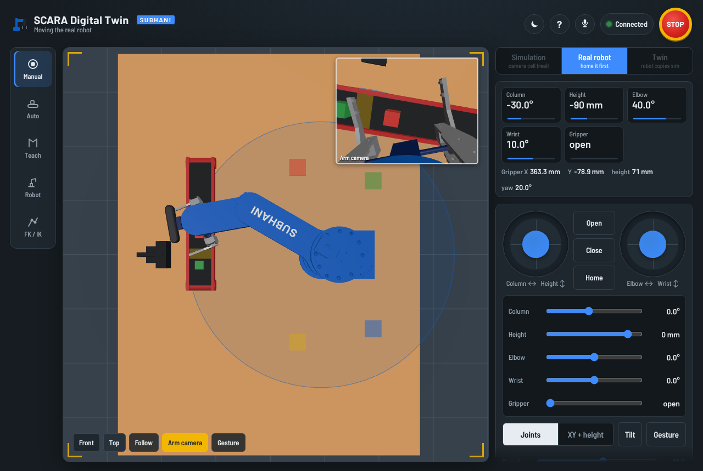
3. **RViz + ROS**, real robot as a see-through ghost next to the simulated one:
   ```bash
   ros2 launch scara_description digital_twin.launch.py sim:=rviz port:=/dev/ttyACM0                  # RViz sliders drive the robot
   ros2 launch scara_description digital_twin.launch.py sim:=rviz mode:=real_to_sim port:=/dev/ttyACM0  # the robot drives RViz
   ros2 launch scara_description digital_twin.launch.py port:=/dev/ttyACM0 cell:=command                # Gazebo cell + sorter, robot copies
   ros2 launch scara_description digital_twin.launch.py port:=/dev/ttyACM0 rosbridge:=true              # + rosbridge for the app
   ros2 launch scara_description digital_twin.launch.py sim:=rviz fake:=true                            # no hardware
   ```
   Commands on `/scara/twin_cmd`: `zero`, `free`, `lock`, `home`, `stop`, `conveyor on`, `conveyor off`.
   The bridge publishes `/real/joint_states` and `/scara/twin_status`.
4. **MuJoCo + ROS + RViz**:
   `ros2 launch scara_description mujoco_ros.launch.py mode:=manual twin:=true port:=/dev/ttyACM0 rviz:=true`
5. **MuJoCo without ROS**:
   ```bash
   python3 mujoco/launch_mujoco.py --auto --twin /dev/ttyACM0     # the sorter drives the real robot
   python3 mujoco/mujoco_twin.py --port /dev/ttyACM0              # MuJoCo follows the real robot
   ```

---

## 13. The name on the shoulder link

The robot has **SUBHANI** in raised letters (19 mm tall, standing 1.6 mm out of the surface) on
the flat top of the shoulder link, centred on the arm and reading from the column towards the elbow.

The letters are **part of the arm mesh itself**: they are merged into `meshes/shoulder_link.stl`, so
the name cannot get lost by deleting or forgetting a file - whoever uses the robot model gets the
name with it. A second thin mesh, `meshes/shoulder_name.stl`, only paints the tops of the letters
white (same frame and scale as the shoulder link, so it cannot slide out of place). Delete that one
and the name is still there, raised, in the arm's blue. It shows in Gazebo, RViz, MuJoCo and the app.

(Nothing stops someone from replacing the arm mesh with one without letters, of course - that is true of any
open file. If you want credit to be a condition of reuse, add a licence that requires attribution,
e.g. CC BY 4.0 for the meshes, and keep your git history as proof of authorship.)

To change the text or size:

```bash
pip install fonttools
python3 tools/make_name_mesh.py --text "SUBHANI" --cap 19 --depth 1.6   # letters into the arm + white paint
python3 tools/make_name_mesh.py --remove                                  # takes the letters off again
python3 tools/build_scene.py          # MuJoCo models
python3 tools/build_app.py            # phone app
colcon build --symlink-install        # Gazebo / RViz pick the new mesh up from the package
```

To edit it in **Blender** instead: `blender --background --python tools/blender_name.py -- --text SUBHANI`
(or open the script in Blender's Scripting tab). It imports the shoulder link, adds the text on the
same spot, and exports `meshes/shoulder_name.stl` (the white letters); you can also move or restyle
the letters by hand and export the name object again (*Selection only*, scale 1). To merge your
Blender letters into the arm too, import both, join them (Ctrl+J) and export as
`meshes/shoulder_link.stl`.

---

## 14. Reference

### 14.1 Launch files

**gazebo.launch.py** – see section 4.

**digital_twin.launch.py**

| argument | default | |
|---|---|---|
| `mode` | `sim_to_real` | `sim_to_real` · `real_to_sim` |
| `sim` | `gazebo` | `gazebo` · `rviz` |
| `cell` | `manual` | `sort` · `command` · `manual` |
| `port` | `/dev/ttyACM0` | Arduino port |
| `fake` | `false` | software robot |
| `homing` | `switches` | `switches` (K, the original build) · `zero` (H) · `none` |
| `rviz` | `true` | |
| `rosbridge` | `false` | rosbridge_server for the phone app |

**mujoco_ros.launch.py**

| argument | default | |
|---|---|---|
| `mode` | `sort` | `sort` · `command` · `manual` |
| `viewer` | `true` | MuJoCo window |
| `rviz` | `false` | |
| `detections` | `vision` | `vision` (rendered camera + OpenCV) · `truth` |
| `pucks` | `0` | 0 = endless |
| `twin` / `port` / `fake` | `false` / `/dev/ttyACM0` / `false` | real robot copies the sim |

### 14.2 Scripts

| program | options |
|---|---|
| `mujoco/launch_mujoco.py` | `--auto` · `--command` · `--voice` · `--show` · `--gui` · `--open` · `--llm` · `--stt` · `--keep-in-bins` · `--capacity N` · `--seed N` · `--twin PORT\|fake` · `--track-belt` (command cell: belt tracking) |
| `server/scara_twin_server.py` | `--sim mujoco\|gazebo\|hardware\|none` · `--port PORT` · `--fake` · `--mode sort\|command` and `--source CAM` (hardware) · `--http 8080` · `--app-port 9090` · `--open` (open the browser) |
| `real_robot/scara_hw_cell.py` | `--port` · `--fake` · `--mode sort\|command` · `--source CAM` · `--teach` · `--zero-here` |
| `real_robot/scara_camera_setup.py` | `--source CAM` · `--distance 60` · `--config FILE` |
| `real_robot/scara_bringup.py` | `--port PORT` · `--no-switches` · `--fake` · `--yes` · `--report FILE` – first start of the real robot, step by step |
| `gazebo/scara_ask.py` | `--voice` · `--llm` · `--stt` · `--quiet` |
| `gazebo/scara_teleop.py`, `mujoco/scara_mujoco_teleop.py` | `--safety safe\|normal\|off` · `--no-assist` |
| `gazebo/scara_joystick.py`, `mujoco/scara_mujoco_joystick.py` | `--device` · `--layout xbox\|gamecontroller` · `--joy-topic` · `--safety` · `--no-assist` (MuJoCo: `--twin`) |
| `gesture_control/gesture_control_mujoco.py` | `--camera N` · `--safety` · `--no-assist` |
| `gesture_control/gesture_control_ros2.py` | ROS params `camera`, `rate`, `safety`, `assist` |
| `mujoco/scara_mujoco_ros.py` | `--world sort\|command\|manual` · `--viewer` · `--detections truth\|vision` · `--pucks N` |
| `mujoco/mujoco_twin.py` | `--port` · `--fake` · `--drive` · `--homing` |
| `gazebo/pick_and_place.py` | `red [N]` |
| `gazebo/scara_doctor.py` | – |
| `tools/make_name_mesh.py` | `--text` · `--cap` · `--depth` · `--font` · `--reverse` |
| `tools/build_app.py` | `--meshes-only` · `--apktool` · `--signer` |

### 14.3 Topics

| topic | type | |
|---|---|---|
| `/joint_states` | sensor_msgs/JointState | |
| `/arm_controller/joint_trajectory`, `/gripper_controller/joint_trajectory` | trajectory_msgs/JointTrajectory | manual control |
| `/arm_controller/follow_joint_trajectory`, `/gripper_controller/…` | control_msgs action | the sorter |
| `/scara/pick_color` | std_msgs/String | colours, `sequence …`, `stop`, `start`, `empty` |
| `/scara/status` | std_msgs/String | what the sorter does |
| `/scara/sorter_state` | std_msgs/String (JSON) | mode, active colours, sequence, totals |
| `/scara/detections` | std_msgs/String (JSON) | pucks seen on the belt |
| `/scara/world_poses` | tf2_msgs/TFMessage | puck poses from Gazebo |
| `/scara/spawn_puck` | std_msgs/String | drop a puck of that colour |
| `/conveyor/speed` | std_msgs/Float64 | belt speed |
| `/fixed_camera/{image,depth_image,camera_info}`, `/arm_camera/image` | sensor_msgs | cameras |
| `/real/joint_states`, `/scara/twin_status`, `/scara/twin_cmd` | | digital twin |
| `/scara/scene_markers` | visualization_msgs/MarkerArray | the cell in RViz |

---

## 15. How the code fits together

```
common/scara_scene.py        every dimension: table, belt, pucks, bins, cameras, heights
   ├─ tools/build_scene.py ─► gazebo/worlds/*.sdf (Gazebo) and mujoco/models/*.xml (MuJoCo)
   ├─ common/scara_kinematics.py     IK / FK with the real link lengths
   ├─ common/scara_vision.py         colour + depth -> 3-D puck positions (simulation cameras)
   ├─ real_robot/scara_cam2d.py      2-D webcam: trained colours + belt ruler (real cell)
   ├─ common/scara_sorter_core.py    sorting / command / sequence logic, stop-and-pick
   │     ├─ gazebo/scara_color_sorter.py   ROS 2 node (Gazebo, MuJoCo-ROS)
   │     ├─ mujoco/launch_mujoco.py        MuJoCo
   │     └─ real_robot/scara_hw_cell.py    the real robot with the webcam
   ├─ common/scara_safety.py         safety mode for every manual control
   ├─ common/scara_voice.py          wake word, speech-to-text, command parsing
   ├─ common/scara_twin_protocol.py  serial protocol to the Arduino + fake robot
   │     ├─ server/scara_twin_server.py      website GUI + phone app + digital twin
   │     ├─ real_robot/scara_twin_bridge.py  ROS 2 twin (RViz ghost)
   │     └─ mujoco/mujoco_twin.py            MuJoCo twin without ROS
   ├─ mujoco/scara_mujoco_ros.py     MuJoCo with the Gazebo ROS interface
   └─ gazebo/scara_rviz_scene.py     the cell in RViz
gesture_control/gesture_core.py   two-hand gestures
real_robot/firmware/scara_twin/              Arduino sketch (HowToMechatronics pins and numbers)
app/ui, app/android               phone app + website (web UI + Android WebView shell)
```

To move something in the cell (a bin, the camera, the belt), change `common/scara_scene.py` and run
`python3 tools/build_scene.py && python3 tools/check_description.py`.

---

## 16. Testing

**One command runs everything this computer can run** and prints a summary (tests whose tools are
missing are listed as skipped, with what to install):

```bash
bash tools/run_all_tests.sh            # all (MuJoCo + Gazebo parts take a few minutes)
bash tools/run_all_tests.sh --quick    # the fast ones, about a minute
```

Every bug fixed so far is listed in [docs/FIXED_BUGS.md](docs/FIXED_BUGS.md) with the test that guards
it – run the tests before every commit and no old bug comes back.

| test | what it checks |
|---|---|
| `tools/test_static.py` | the old bugs that need no simulator: browser opening, joint settings, robot limits, WebSocket, camera on the forearm, voice phrases, Android permission, install rules, no undefined names in any program |
| `tools/check_description.py` | URDF tree, the three worlds, reachability |
| `common/scara_kinematics.py`, `scara_safety.py`, `scara_twin_protocol.py` | IK/FK round trip, safety filter, robot protocol + software robot |
| `tools/test_firmware_host.py` | compiles the Arduino sketch on the PC (3 variants) and drives it over its serial protocol |
| `tools/test_gesture_core.py` | two-hand gestures with synthetic hands |
| `tools/test_app_v3.py` | the app / website offline: worlds, voice, sliders, keyboard, gesture (with `make_hand_video.py`), FK / IK, recording, every phone width, dark / light, arm-camera resize |
| `tools/test_gesture_mediapipe.py` | MediaPipe hand tracking with a video made from real hand photos (`make_hand_video.py --real`): offline from `file://` like the Android app and over http like the website; the hand moves the column, fist / open close and open the gripper, a second hand is the right joystick, the tracker switch, and the on-screen reasons for a refused camera and plain http |
| `tools/test_new_features.py` | 3.3 in the app offline: a drawn / star path is followed (within 6 mm), out-of-reach paths refused, programs saved / exported / imported / loaded, a broken file refused, belt tracking picks from the moving belt, the review demo runs and stops |
| `real_robot/scara_bringup.py --fake --yes` | the hardware bring-up check against the software robot |
| `tools/test_camera_gamepad.py` | gesture camera Docked / Window / Small / closed on phone, tablet and PC (never covers or shrinks the robot view) and a gamepad driving the arm and the gripper |
| `tools/test_hw_twin.py` | the webcam cell as a twin: belt from the taught poses, cubes where they are, IK Go on the robot |
| `tools/test_twin_e2e.py` | the digital twin: MuJoCo + software robot – Twin moves, robot limits, direction check, STOP, robot not answering, worlds, the app |
| `tools/sim_test_manual.py`, `sim_test_sorting.py`, `test_hw_cell.py` | MuJoCo physics: manual picks, sorting and command cells, belt tracking (`TRACK=1`: most picks on the moving belt, nothing lost), the webcam cell (through `tools/mujoco_harness.py`) |
| `tools/test_gazebo.py` | Gazebo through the server, headless: picks with the twin, world switches, nothing left over, clean stop |

`python3 tools/make_app_media.py` re-makes the README pictures of the app.

What was run for 3.3.0 (27 October 2026, Ubuntu 22.04, ROS 2 Humble, Gazebo Harmonic 8.15, MuJoCo
3.12, Chromium 156 through Playwright): the full `tools/run_all_tests.sh` – 21 passed, 0 failed,
0 skipped (details in CHANGELOG.md). Before the changes the same suite on this PC gave 13 passed, 4 failed (bugs #33–#36).

What was run for earlier releases:
* Gazebo Harmonic (headless, the Jazzy builds of ros_gz and gz_ros2_control) with the real launch
  file in all three modes: belt, pucks, controllers, sorter, command mode, manual control through
  the twin server, and the doctor script.
* MuJoCo sorting and command runs, the manual picks with and without the safety mode, the
  camera cell dry run (`test_hw_cell.py`, sorting and command mode – every cube picked, no misses).
* The firmware compiled on the PC with mock Arduino headers in all three configurations and driven
  through its serial protocol, including the limit-switch homing.
* The phone app in a phone-sized browser: joystick and XY picks, tilt, teach & replay, sequences and
  the sorting / command cells offline; against the PC: MuJoCo (manual pick with the joysticks, world
  switching to the command cell and a sequence) and Gazebo (moves through the twin server).
* The phone app's UI at phone sizes in Chrome against the real twin server, and the APK built,
  signed and checked with apktool.
* Version 3.1: `tools/run_all_tests.sh` – every test above passed (MuJoCo through the C harness,
  Gazebo Harmonic headless with the package built and installed by CMake). `tools/mujoco_harness.py`
  (the same harness on the `mujoco` Python package) could not be run in the build machine.
* Version 3: switching worlds back and forth (nothing of the old world left), voice commands, the
  sliders, the keyboard, hand control with a recorded hand video as the camera, FK against the
  simulator, IK *Go* offline and on the (software) robot, the hardware twin against a test picture
  of the belt, and the layouts at phone, landscape and desktop sizes.

---

## 17. Troubleshooting

**Gazebo "crashes" / the arm does not move** – usually Gazebo itself is fine and a node behind it
stopped. Look in the terminal for the first `process has died`:
* `scara_color_sorter.py` / `scara_vision_node.py` / `scara_puck_spawner.py` died with
  `ModuleNotFoundError` – a build from before 3.3 with `--symlink-install` (bug #36): update, then
  `colcon build --symlink-install` again.
* the `spawner` processes died – the controllers did not come up. 3.3 waits 60 s and first stops an
  old SCARA Gazebo that was still running (`stop_old:=false` turns that off). Still failing:
  `pkill -f "gz sim"`, then launch again.
* Gazebo's own window closes with an OpenGL / Ogre error – a graphics-driver problem: try
  `headless:=true`, or `export LIBGL_ALWAYS_SOFTWARE=1` before the launch.

**Gazebo: belt / pucks / arm don't move** – run `python3 gazebo/scara_doctor.py` and fix the first
FAIL. The usual ones: the gz_ros2_control plugin is not found (section 2.3), Gazebo is paused (press
▶), no camera images (GPU driver), an old build (`colcon build` again).

* **Controllers not active** – `ros2 control list_controllers` must show `joint_state_broadcaster`,
  `arm_controller` and `gripper_controller` as active.
* **Pucks never appear** – the spawner prints "Could not spawn …" with the reason.
* **Z stops above a puck, "a finger is over the puck"** – the gripper is not over the puck; bring
  it closer and the pick assist takes over.
* **The arm is slow** – that is the safe mode; switch to *Normal* or raise the speed slider.
* **Nothing moves, "EMERGENCY STOP"** – press STOP / Space / BACK again to release.
* **GUI shows "Offline"** – it was opened from the disk; run `scara_twin_server.py` and use
  http://localhost:8080 (it connects by itself), or tap the pill and connect.
* **Voice: "needs internet" / nothing happens** – in a browser speech is online and needs
  localhost or https; on the phone install offline speech (section 9). You can always type.
* **Gesture control does nothing** – read the text in the camera window: it says why (camera refused,
  plain http from another computer, no hand seen, too dark). The blue *MediaPipe hand tracking* label
  means the real hand tracker runs; with *Simple colour tracking* fill the yellow square with your open
  palm, plain background behind it, then *Learn again*.
* **Gazebo world switch takes long** – it restarts Gazebo (about 30 s); the overlay says so.
* **Phone app doesn't connect** – same Wi-Fi, `sudo ufw allow 9090`, and only one of
  `scara_twin_server.py` / `rosbridge_server` running.
* **`Permission denied: /dev/ttyACM0`** – `sudo usermod -aG dialout $USER`, log out and in.
* **`W not homed`** – home it with `K` (*Home on limit switches*), or on a robot without switches put the arm at the ready pose and press *Zero here*.
* **A real joint turns the wrong way** – app / website, Robot tab, **Direction check**: *Nudge* the joint, and if the real arm moved the other way press *Opposite* (saved in `~/.scara_twin_hardware.yaml`, used by every program). Or flip its `*_sign` in `config/twin_hardware.yaml` by hand.
* **Camera cell: "Cannot start: …"** – it lists what is missing (colours, ruler, poses, zero).
* **Camera cell picks a little beside the cube** – redo the ruler (`P`, `U`, and `D` for a side
  view) and check the `pick` pose is exactly around a cube at the pick point.
* **Camera cell misses colours** – teach that colour again with more clicks, or under the light
  you will run with; check the belt box (`R`) covers the whole pick zone.
* **Voice: no microphone** – `sudo apt install portaudio19-dev && pip install pyaudio`.
* **Joystick does nothing** – `ls /dev/input/js*`, the `input` group, `--layout gamecontroller`.

---

## 18. Licence, credits and author

**Author:** Shaik Subhani – [@Iamsubhani11](https://github.com/Iamsubhani11)

Released under the [MIT License](LICENSE) – © 2026 Shaik Subhani. You may use, change and share it,
also commercially, as long as the copyright notice stays with it.

The mechanical design is the SCARA robot by Dejan Nedelkovski,
[HowToMechatronics](https://howtomechatronics.com/projects/scara-robot-how-to-build-your-own-arduino-based-robot/).
The app ships three.js (MIT) and the Barlow fonts (SIL OFL 1.1). Details in [NOTICE.md](NOTICE.md).

If this project helps your own robot, a ⭐ on GitHub is appreciated.
